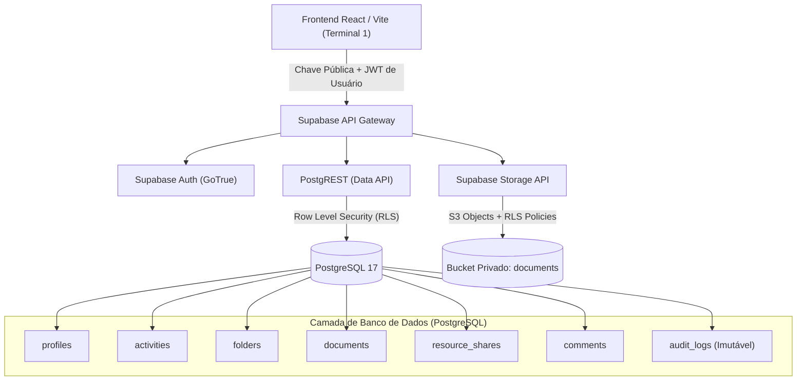

# 01. Arquitetura do Backend — AssistSocial

## 1. Visão Geral

O **AssistSocial** é uma plataforma desenvolvida para assistentes sociais organizarem suas atividades de rotina, visitas domiciliares, relatórios técnicos, atendimento a famílias vulneráveis e arquivamento seguro de documentos comprobatórios.

Devido à natureza dos dados socioassistenciais (informações sensíveis amparadas por sigilo profissional e LGPD), a arquitetura do backend prioriza:
- **Segurança Granular:** Controle de acesso em nível de linha (RLS) no PostgreSQL.
- **Autenticação Centralizada:** Supabase Auth integrado com ciclo de vida de perfis (`public.profiles`).
- **Armazenamento Privado:** Supabase Storage com arquivos isolados por identificador de usuário (`owner_id`) e acesso condicionado a compartilhamentos explícitos.
- **Trilha de Auditoria Imutável:** Histórico de alterações e compartilhamentos para conformidade técnica e legal.

---

## 2. Diagrama de Arquitetura

---

## 3. Preparação Arquitetural para Inteligência Artificial (Sem Chamadas Externas)

Conforme estabelecido nas diretrizes do projeto:
1. **Nenhum serviço externo de IA é invocado nesta fase**. Documentos sociais possuem sigilo legal e demandam consentimento e conformidade estrita antes de processamento em nuvens de terceiros.
2. A estrutura de dados já está preparada na tabela `public.documents`:
   - `ai_analysis_status`: Estado da fila de análise (`not_requested`, `pending`, `processing`, `completed`, `failed`).
   - `ai_summary`: Campo de texto para resumos gerados.
   - `ai_metadata`: Campo `JSONB` flexível para entidades identificadas, tags de vulnerabilidade, datas críticas e diagnósticos recomendados.
3. Quando a funcionalidade de IA for homologada, poderá ser operada via **Supabase Edge Functions** ou worker seguro desacoplado, sem necessidade de alterar o esquema do banco de dados nem quebrar a compatibilidade com o frontend.
