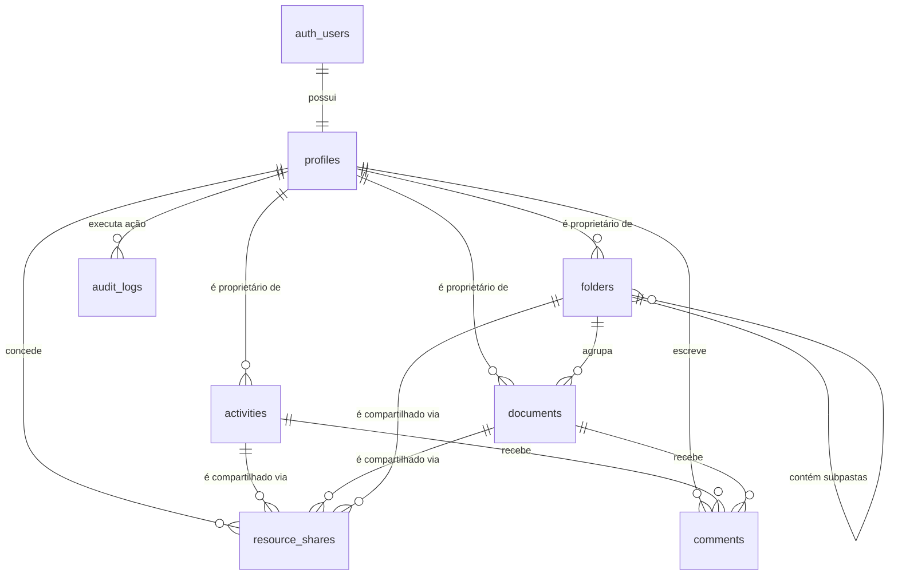

# 02. Modelo de Dados e Relacionamentos

## 1. Diagrama Entidade-Relacionamento (ERD)

---

## 2. Dicionário de Tabelas

### 2.1 `public.profiles`
Armazena informações cadastrais dos profissionais de assistência social. O `id` referencia `auth.users(id)`.
- `id` (UUID, PK): Chave primária ligada à identidade autenticada.
- `full_name` (TEXT): Nome completo do profissional.
- `email` (TEXT): Endereço de e-mail institucional.
- `phone` (TEXT): Telefone / ramal.
- `avatar_url` (TEXT): Foto de perfil.
- `role` (TEXT): Papel no sistema (`social_worker`, etc.).
- `created_at` / `updated_at` (TIMESTAMPTZ): Timestamps automáticos.

### 2.2 `public.activities`
Atividades profissionais (atendimentos, reuniões, visitas domiciliares, relatórios).
- `id` (UUID, PK): Identificador único gerado automaticamente.
- `owner_id` (UUID, FK -> profiles.id): Assistente social responsável.
- `title` (TEXT): Título da atividade.
- `description` (TEXT, Nullable): Detalhamento do atendimento ou compromisso.
- `starts_at` (TIMESTAMPTZ): Início da atividade.
- `ends_at` (TIMESTAMPTZ, Nullable): Fim estimado ou real.
- `category` (TEXT): Categoria (`atendimento`, `reuniao`, `visita_domiciliar`, `elaboracao_relatorio`, `outros`).
- `status` (TEXT): Situação (`pending`, `in_progress`, `completed`, `not_completed`, `rescheduled`, `cancelled`).
- `failure_reason` (TEXT, Nullable): Justificativa obrigatória caso não concluída.
- `recurrence_rule` (TEXT, Nullable): Padrão RRULE para atividades recorrentes.
- `reminder_minutes` (INTEGER): Minutos de antecedência para notificações.
- `created_at` / `updated_at` (TIMESTAMPTZ).

### 2.3 `public.folders`
Organização de prontuários e arquivos em árvore hierárquica.
- `id` (UUID, PK): Identificador da pasta.
- `owner_id` (UUID, FK -> profiles.id): Dono da pasta.
- `name` (TEXT): Nome visível da pasta.
- `parent_folder_id` (UUID, FK -> folders.id, Nullable): Pasta pai (ou NULL para pastas raiz).
- `created_at` / `updated_at` (TIMESTAMPTZ).
> **Validação de Ciclos:** Possui a trigger `trg_check_folder_cycle` que impede que uma pasta seja configurada como filha de si mesma ou de qualquer um de seus descendentes.

### 2.4 `public.documents`
Metadados dos arquivos anexados (os binários reais ficam no Supabase Storage).
- `id` (UUID, PK): Identificador do documento.
- `owner_id` (UUID, FK -> profiles.id): Proprietário.
- `folder_id` (UUID, FK -> folders.id, Nullable): Pasta onde o arquivo está alocado.
- `original_name` (TEXT): Nome original do arquivo enviado pelo usuário.
- `display_name` (TEXT): Nome descritivo de exibição no sistema.
- `storage_path` (TEXT, Unique): Caminho de referência no bucket Storage (`owner_id/nome_arquivo`).
- `mime_type` (TEXT): Tipo MIME (`application/pdf`, etc.).
- `file_size` (BIGINT): Tamanho em bytes.
- `ai_analysis_status` (TEXT): Estado de prontidão para IA.
- `ai_summary` (TEXT, Nullable): Resumo extraído por IA futura.
- `ai_metadata` (JSONB): Metadados estruturados de IA futura.
- `created_at` / `updated_at` (TIMESTAMPTZ).

### 2.5 `public.resource_shares`
Controle de compartilhamento granular de recursos entre assistentes sociais.
- `id` (UUID, PK): Identificador do compartilhamento.
- `owner_id` (UUID, FK -> profiles.id): Usuário que compartilhou.
- `resource_type` (TEXT): Tipo (`activity`, `document`, `folder`).
- `resource_id` (UUID): ID do recurso compartilhado.
- `invited_user_id` (UUID, FK -> profiles.id, Nullable): Destinatário já cadastrado.
- `invited_email` (TEXT, Nullable): Destinatário convidado via e-mail.
- `permission` (TEXT): Nível (`viewer`, `commenter`, `editor`).
- `status` (TEXT): Estado (`pending`, `accepted`, `revoked`, `expired`).
- `expires_at` (TIMESTAMPTZ, Nullable): Expiração automática opcional.
- `revoked_at` (TIMESTAMPTZ, Nullable): Registro temporal de revogação.
- `created_at` / `updated_at` (TIMESTAMPTZ).

### 2.6 `public.comments`
Comentários colaborativos em atividades e documentos.
- `id` (UUID, PK): Identificador do comentário.
- `author_id` (UUID, FK -> profiles.id): Autor do comentário.
- `resource_type` (TEXT): `activity` ou `document`.
- `resource_id` (UUID): ID do recurso comentado.
- `content` (TEXT): Texto do comentário.
- `created_at` / `updated_at` (TIMESTAMPTZ).

### 2.7 `public.audit_logs`
Trilha imutável para conformidade técnica e pericial.
- `id` (UUID, PK).
- `actor_id` (UUID, FK -> profiles.id, Nullable): Usuário que realizou a ação.
- `action` (TEXT): Ação (`activity.status_changed`, `share.created`, `share.accepted`, `share.revoked`, etc.).
- `resource_type` (TEXT): Tipo do recurso auditado.
- `resource_id` (UUID): ID do recurso auditado.
- `details` (JSONB): Detalhes da alteração (valores anteriores e novos).
- `created_at` (TIMESTAMPTZ): Data e hora exata.
