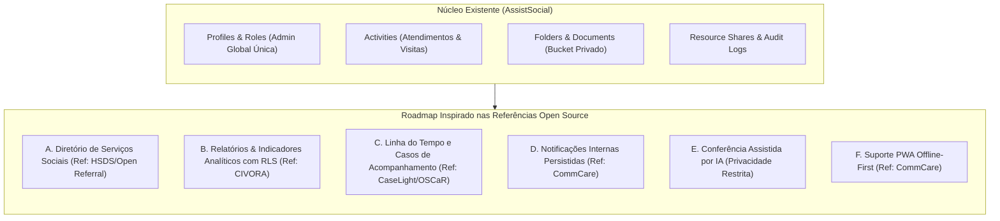

# 09. Pesquisa de Referências Open Source, Auditoria e Matriz de Funcionalidades

Este documento consolida a pesquisa aprofundada de sistemas de código aberto voltados a serviços sociais, gestão de casos (*case management*) e assistência pública, a auditoria detalhada da arquitetura atual do **AssistSocial**, a análise de licenças de software e a matriz estratégica de evolução da plataforma.

---

## 1. FASE 1 — Pesquisa de Referências Open Source

Foram investigadas seis iniciativas de referência internacional e comunitária no ecossistema de assistência social e direitos humanos:

### 1. CaseLight (`Lighthouse-Nonprofit/caselight`)
- **Foco Primário:** Sistema ágil de gestão de casos para organizações sem fins lucrativos e serviços comunitários.
- **Licença:** MIT License (permissiva).
- **Arquitetura Conceitual:** Modelo centrado em Beneficiários (*Clients/Beneficiaries*), Casos (*Cases*) e Encontros/Atendimentos (*Intakes, Encounters, Notes*). Possui formulários de triagem rápida e histórico temporal de anotações.
- **Requisitos de Dados:** Estrutura relacional leve vinculando múltiplos atendimentos a um caso único, com controle de sigilo por equipe responsável.
- **Aplicabilidade ao AssistSocial:** Inspiração ideal para a criação de um modelo de "Linha do Tempo de Atendimento", onde cada atendimento (atualmente na tabela `activities`) possa opcionalmente ser agrupado por um histórico continuado de acompanhamento familiar.

### 2. CiviCRM / CiviCase (`civicrm/civicrm-core`)
- **Foco Primário:** Gestão corporativa de casos complexos para o terceiro setor e setor público.
- **Licença:** GNU AGPL v3 (Affero General Public License — *copyleft forte*).
- **Arquitetura Conceitual:** Gerenciamento de fluxos de trabalho através de tipos de caso padronizados (*Case Types*), papéis definidos (*Case Coordinator, Caseworker, Supervisor*) e linha do tempo de atividades vinculadas.
- **Requisitos de Dados:** Máquina de estados estrita (Aberto, Em Análise, Em Acompanhamento, Encaminhado, Fechado/Arquivado), com controle rigoroso de quem pode reabrir ou encerrar um caso.
- **Análise de Licença e Risco:** Devido à licença AGPL v3, **nenhum trecho de código pode ser copiado diretamente** para o AssistSocial, sob risco de contaminação jurídica que exigiria disponibilizar publicamente o código de rede. A adoção restringe-se à **inspiração conceitual** dos fluxos de transição de estado e papéis de equipe.

### 3. CommCare HQ (`dimagi/commcare-hq`)
- **Foco Primário:** Plataforma líder para agentes de campo comunitários e visitadores sociais em regiões remotas.
- **Licença:** BSD 3-Clause (permissiva).
- **Arquitetura Conceitual:** Modelo *offline-first* robusto, permitindo o preenchimento de visitas domiciliares sem conectividade com a internet e sincronização posterior em lote, com resolução de conflitos e criptografia local.
- **Requisitos de Dados:** Registro de metadados de sincronização (`client_timestamp`, `server_timestamp`, `conflict_flag`), purge de cache local sensível no *sign-out* e integridade em trânsito.
- **Aplicabilidade ao AssistSocial:** Diretriz fundamental para visitas domiciliares de assistentes sociais do SUAS (CRAS/CREAS), onde a conexão móvel pode ser intermitente durante visitas a famílias em áreas de vulnerabilidade.

### 4. OSCaR (Open-source Social Case Action & Reporting)
- **Foco Primário:** Sistema de gestão de casos sociais com ênfase na proteção de crianças, adolescentes e populações em situação de risco.
- **Licença:** GNU AGPL v3 (copyleft forte).
- **Arquitetura Conceitual:** Planos de Cuidados Individuais (*Individual Care Plans - ICP*), avaliação periódica de metas de desenvolvimento familiar, encaminhamentos a redes externas e indicadores de progresso social.
- **Requisitos de Dados:** Dados sensíveis de alta criticidade (situações de violência, acolhimento institucional, violação de direitos), exigindo autorizações explícitas de visualização apenas para profissionais diretamente vinculados ao caso.
- **Aplicabilidade ao AssistSocial:** Referência para a elaboração de Planos de Acompanhamento Familiar (PAIF/PAEFI), respeitando o sigilo ético do Código de Ética do Assistente Social (CFESS/CRESS).

### 5. Open Referral / HSDS (`openreferral/specification`)
- **Foco Primário:** Especificação padrão aberta para diretórios de serviços humanos e redes de assistência social (*Human Services Data Specification*).
- **Licença:** Creative Commons Attribution 4.0 International (CC-BY 4.0) & Open Data Commons.
- **Arquitetura Conceitual:** Modelo de dados padronizado para mapear recursos sociais:
  - `Organization` (Órgãos gestores, ONGs, entidades públicas)
  - `Service` (Serviços oferecidos, ex.: Acolhimento, Concessão de Cesta Básica, Apoio Psicológico)
  - `Location` (Endereços físicos de atendimento, CRAS, CREAS, CAPS)
  - `Schedule` (Horários de funcionamento regulares e especiais)
  - `Contact` (Telefones, e-mails e pontos focais)
  - `Eligibility` (Critérios de acesso, renda, documentos exigidos)
- **Aplicabilidade ao AssistSocial:** Estrutura pronta e interoperável para a criação do **Diretório Municipal de Serviços Sociais**, permitindo que os assistentes sociais encontrem imediatamente os pontos de encaminhamento adequados na rede socioassistencial.

### 6. CIVORA (`alrazihi/civora`)
- **Foco Primário:** CRM e painel analítico para gestão de doações e acompanhamento de beneficiários.
- **Licença:** MIT License.
- **Arquitetura Conceitual:** Painéis de métricas com indicadores de volume de atendimentos, taxas de cumprimento de prazos e distribuição de demandas por categoria.
- **Aplicabilidade ao AssistSocial:** Inspiração para relatórios consolidados e indicadores de produtividade do profissional sem violação do RLS.

---

## 2. FASE 2 — Auditoria da Arquitetura Atual do AssistSocial

| Componente | Implementação no Repositório | Estado da Migração Local | Estado Remoto Supabase | Estado de Testes |
| :--- | :--- | :--- | :--- | :--- |
| **`profiles`** | [`supabase/migrations/20261027170001_initial_schema.sql`](file:///C:/Users/Londres31/Documents/DEV/supabase/migrations/20261027170001_initial_schema.sql) | Aplicada / Validada | Aplicada no banco remoto | ✅ 100% testada (RLS e isolamento) |
| **`activities`** | 7 categorias, controle de status, recorrência e lembretes | Aplicada / Validada | Aplicada no banco remoto | ✅ 100% testada (operações e RLS) |
| **`folders` & `documents`** | Anti-ciclo em pastas e metadados de arquivos | Aplicada / Validada | Aplicada no banco remoto | ✅ 100% testada (Storage e pastas) |
| **`resource_shares`** | Compartilhamento seguro entre profissionais com expiração | Aplicada / Validada | Aplicada no banco remoto | ✅ 100% testada (revogação e permissão) |
| **`comments`** | Anotações em atividades/documentos compartilhados | Aplicada / Validada | Aplicada no banco remoto | ✅ 100% testada (RLS) |
| **`audit_logs`** | Auditoria forense com trigger e função `log_audit_event` | Aplicada / Validada | Aplicada no banco remoto | ✅ 100% testada |
| **Segurança de Papéis** | Trava de unicidade `idx_single_global_admin` e trigger anti-escalada | Aplicada / Validada | Aplicada no banco remoto | ✅ 100% testada |
| **Edge Function `admin-invite-user`** | Código Deno com validação JWT, CORS e força `social_worker` | Implementada / Validada | Código pronto (Deploy CLI pendente) | ✅ 5 testes unitários aprovados |
| **Storage `documents`** | Bucket privado de 50MB com MIME types restritos | Configurado | Configurado | ✅ Testado via suíte RLS |

> **Diferenciação Estrita:** Todas as migrações (01 a 06) e a conta da Administradora Global Janaína Lima estão ativas e confirmadas no projeto Supabase remoto (`mnhzikgphdhohlhfsljz`). Apenas a implantação física da Edge Function no runtime Deno remoto aguarda a execução do comando CLI com token.

---

## 3. FASE 3 — Proposta e Matriz de Novas Funcionalidades

### Detalhamento das Funcionalidades Propostas:

#### A. Diretório de Serviços Sociais (Inspirado no Open Referral / HSDS)
- **Objetivo:** Catálogo público/institucional de equipamentos sociais (CRAS, CREAS, Postos de Saúde, Conselhos Tutelares, Albergues, Centros POP) para consulta rápida e encaminhamento de famílias.
- **Requisitos de Dados:** Tabelas `social_services` e `service_locations` contendo nome, categoria, endereço, horários de atendimento, requisitos de documentação e canais de contato.
- **Regras de Autorização:** Leitura pública para todos os assistentes sociais autenticados; edição restrita a administradores ou supervisores. Dados estritamente institucionais (nenhum dado de usuário final).
- **Prioridade:** Média-Alta | **Esforço:** Médio.

#### B. Relatórios e Indicadores Seguros (Inspirado no CIVORA)
- **Objetivo:** Função PostgreSQL RPC segura com RLS para consolidar métricas pessoais do profissional (atendimentos concluídos, visitas pendentes, relatórios em atraso, taxa de conclusão mensal) sem que o cliente precise carregar centenas de registros na memória do navegador.
- **Garantias de Privacidade:** A agregação ocorre no próprio banco via `auth.uid()`, impossibilitando que um profissional veja métricas individuais de colegas sem compartilhamento explícito.
- **Prioridade:** **Alta (Executável Imediatamente)** | **Esforço:** Baixo.

#### C. Linha do Tempo de Atendimento e Casos (Inspirado em CaseLight / OSCaR)
- **Objetivo:** Agrupar atendimentos e visitas sob a ótica de um "Prontuário de Acompanhamento Familiar", registrando evolução histórica, planos de metas e encaminhamentos.
- **Segurança Ética (CFESS/CRESS & LGPD):**
  - Dados mínimos necessários (evitar excesso de dados pessoais desnecessários).
  - Acesso restrito exclusivamente ao profissional responsável e à equipe explicitamente autorizada via `resource_shares`.
  - Proibição absoluta de exposição pública ou compartilhamento não autenticado.
- **Prioridade:** Alta (Requer aprovação de contrato prévio com o Terminal 1) | **Esforço:** Alto.

#### D. Notificações e Lembretes Internos
- **Objetivo:** Notificações no sistema para prazos judiciais iminentes, visitas agendadas para o dia e relatórios atrasados.
- **Arquitetura Sustentável:** Tabela interna `notifications` gerenciada via triggers no banco de dados, sem contratação de serviços pagos de push ou SMS de terceiros.
- **Prioridade:** Média | **Esforço:** Baixo-Médio.

#### E. Conferência Assistida por IA (Checklist de Documentos)
- **Objetivo:** Auxiliar a assistente social na checagem de elegibilidade documental para benefícios (ex.: Benefício de Prestação Continuada - BPC ou Bolsa Família), verificando se a lista de documentos necessários foi anexada à pasta.
- **Restrições Éticas Severas:**
  - **Nenhuma decisão automática:** A IA nunca defere, indefere ou julga situações de vulnerabilidade ou elegibilidade. O julgamento técnico é privativo da assistente social.
  - **Privacidade de Dados:** Nenhum documento pessoal ou laudo social é enviado a modelos públicos sem anonimização prévia e termo de consentimento explícito.
- **Prioridade:** Baixa | **Esforço:** Alto.

#### F. Funcionamento Offline (PWA) (Inspirado no CommCare)
- **Objetivo:** Permitir anotações preliminares de visitas domiciliares em locais sem sinal de internet.
- **Controle de Risco:** Armazenamento temporário seguro em IndexedDB e **purga obrigatória de dados sensíveis locais ao efetuar logout** para evitar vazamento em dispositivos compartilhados.
- **Prioridade:** Média-Baixa (Fase futura) | **Esforço:** Alto.

---

## 4. FASE 4 — Análise de Licenças e Política de Reutilização de Código

| Projeto | Repositório | Licença | Compatibilidade com AssistSocial | Política de Reutilização Recomendada |
| :--- | :--- | :--- | :--- | :--- |
| **CaseLight** | `Lighthouse-Nonprofit/caselight` | MIT License | Compatível | Reutilização de padrões de dados e modelos; inspiração arquitetural. |
| **CiviCRM / CiviCase** | `civicrm/civicrm-core` | GNU AGPL v3 | **Incompatível para cópia de código** (Exigiria abertura de rede de todo o backend). | **Estritamente inspiração conceitual limpa**. Nenhum código copiado. |
| **CommCare HQ** | `dimagi/commcare-hq` | BSD 3-Clause | Compatível com preservação de copyright | Inspiração conceitual para sincronização offline e purga de cache. |
| **OSCaR** | `OSCaR-Development` | GNU AGPL v3 | **Incompatível para cópia de código** | **Apenas inspiração conceitual** para planos de acompanhamento familiar. |
| **Open Referral / HSDS** | `openreferral/specification` | CC-BY 4.0 / Open Data | Compatível | Adoção integral da especificação de schema para o diretório de serviços. |
| **CIVORA** | `alrazihi/civora` | MIT License | Compatível | Inspiração para consultas analíticas e agregação de indicadores. |

> **Diretriz de Propriedade Intelectual:** O AssistSocial desenvolve 100% de seu código em TypeScript e SQL nativos para Supabase/PostgreSQL. A adoção de referências open source ocorre sob o princípio de **Clean Room Design**, garantindo conformidade jurídica absoluta e independência de bibliotecas AGPL.

---

## 5. Matriz de Prioridade, Impacto e Esforço

| Funcionalidade | Impacto no Usuário | Risco de Segurança / Privacidade | Esforço Técnico | Dependências Externas | Prioridade de Implementação |
| :--- | :---: | :---: | :---: | :---: | :---: |
| **1. Indicadores Analíticos Seguros (RPC)** | Alto | Baixo (RLS nativo) | Baixo | Nenhuma | 🟢 **Imediata (Sprint Atual)** |
| **2. Diretório de Serviços Sociais (HSDS)** | Alto | Baixo (Dados públicos) | Médio | Nenhuma | 🟡 **Fase 2** |
| **3. Notificações Internas Persistentes** | Médio | Baixo | Baixo | Nenhuma | 🟡 **Fase 2** |
| **4. Linha do Tempo e Prontuários (Casos)** | Altíssimo | Alto (Sigilo CFESS) | Alto | Contrato Frontend | 🟠 **Fase 3** |
| **5. Suporte Offline PWA** | Alto | Médio (Dados em trânsito/repouso) | Alto | Service Workers | ⚪ **Fase 4** |
| **6. Conferência de Documentos por IA** | Médio | Altíssimo (LGPD / Privacidade) | Alto | Provedor LLM Privado | ⚪ **Fase 5 (Avaliação Ética)** |
