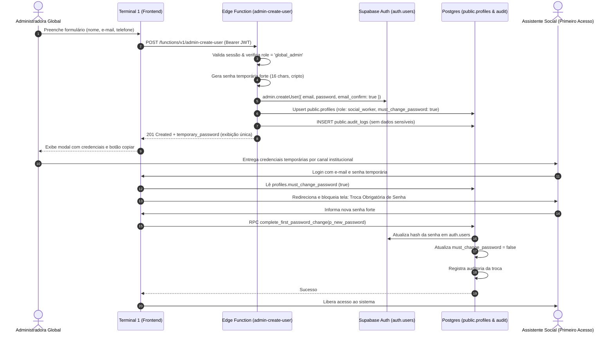

# 10. Cadastro Administrativo sem E-mail e Troca Obrigatória de Senha

Este documento especifica formalmente o contrato de backend implementado para o **AssistSocial**, destinado à integração com o Frontend (Terminal 1) e governança operacional.

---

## 1. Visão Geral da Arquitetura

O fluxo administrativo permite que a **Administradora Global** crie novos profissionais (assistentes sociais) diretamente no sistema sem depender de provedor de e-mail transacional (SMTP) ou disparo de links externos (`inviteUserByEmail`).



---

## 2. Nomes das Edge Functions e Compatibilidade

Para garantir 100% de compatibilidade tanto com novos desenvolvimentos quanto com o código legado do frontend:

| Nome da Função | Endpoint URL | Finalidade |
| :--- | :--- | :--- |
| **`admin-create-user`** (Principal) | `https://mnhzikgphdhohlhfsljz.supabase.co/functions/v1/admin-create-user` | Endpoint canônico da especificação atual. |
| **`admin-invite-user`** (Legado / Compatibilidade) | `https://mnhzikgphdhohlhfsljz.supabase.co/functions/v1/admin-invite-user` | Atualizado com o exato mesmo contrato para suportar chamadas legadas do frontend sem quebras. |

---

## 3. Contrato da API (Requisição e Resposta)

### 3.1. Cabeçalhos Obrigatórios (Headers)

```http
POST /functions/v1/admin-create-user HTTP/1.1
Host: mnhzikgphdhohlhfsljz.supabase.co
Authorization: Bearer <JWT_DA_ADMINISTRADORA_GLOBAL>
apikey: <SUPABASE_ANON_KEY>
Content-Type: application/json
```

### 3.2. Formato da Requisição (Payload)

Aceita tanto campos em `snake_case` quanto `camelCase`:

```json
{
  "email": "maria.silva@cras.gov.br",
  "full_name": "Maria da Silva Pereira",
  "phone": "(11) 98765-4321"
}
```

> **Atenção:** Qualquer tentativa do cliente de enviar `role`, `email_confirm` ou flags privilegiadas é solenemente ignorada e descartada pelo servidor. O papel é fixado incondicionalmente como `'social_worker'`.

### 3.3. Formato da Resposta de Sucesso (`201 Created`)

```json
{
  "success": true,
  "message": "Profissional cadastrado com sucesso. Nenhuma mensagem por e-mail foi disparada.",
  "user": {
    "id": "f47ac10b-58cc-4372-a567-0e02b2c3d479",
    "email": "maria.silva@cras.gov.br",
    "full_name": "Maria da Silva Pereira",
    "role": "social_worker",
    "must_change_password": true
  },
  "temporary_password": "K7#mP9$xL2@qR5*z"
}
```

> **Comportamento da Senha Temporária:**
> - Gerada no servidor via gerador pseudo-aleatório criptográfico (`crypto.getRandomValues`).
> - Tamanho de 16 caracteres garantindo alta entropia (maiúsculas, minúsculas, números e caracteres especiais).
> - Retornada **uma única vez** nesta resposta HTTP para exibição na modal do frontend.
> - **Nunca** é salva em texto puro no banco de dados.
> - **Nunca** é registrada em `public.audit_logs` nem nos logs de console/Edge Function.
> - **Nunca** é enviada por e-mail.

### 3.4. Erros HTTP Possíveis

| Status | Código / Motivo | Exemplo de Resposta |
| :--- | :--- | :--- |
| **`400 Bad Request`** | Parâmetro inválido ou ausente | `{"error": "E-mail inválido ou ausente."}` ou `{"error": "O nome completo é obrigatório."}` |
| **`401 Unauthorized`** | Token JWT ausente ou expirado | `{"error": "Não autorizado: Token de autenticação ausente."}` |
| **`403 Forbidden`** | Chamador não é `global_admin` | `{"error": "Acesso negado: Apenas a Administradora Global pode cadastrar novos profissionais."}` |
| **`405 Method Not Allowed`**| Método HTTP diferente de POST/OPTIONS | `{"error": "Método não permitido. Utilize POST."}` |
| **`409 Conflict`** | E-mail já cadastrado | `{"error": "Este e-mail já está cadastrado no sistema."}` |
| **`500 Internal Error`** | Falha de serviço ou infraestrutura | `{"error": "Falha ao consolidar perfil institucional. Usuário removido para evitar inconsistência: ..."}` |

---

## 4. Garantias de Integridade e Rollback Seguro (Anti-Órfãos)

Para evitar a criação de contas órfãs no Supabase Auth caso ocorra uma falha de rede ou validação no banco de dados relacional:

1. O usuário é instanciado em `auth.users` via `adminClient.auth.admin.createUser()`.
2. Em seguida, o perfil institucional é consolidado na tabela `public.profiles`.
3. Caso a inserção/atualização em `public.profiles` falhe:
   - A Edge Function executa imediatamente uma **estratégia de compensação**: invoca `adminClient.auth.admin.deleteUser(newUserId)`.
   - Isso expurga o usuário recém-criado de `auth.users`, impedindo a persistência de contas inconsistentes e permitindo nova tentativa.

---

## 5. Mecanismo de Troca Obrigatória de Senha

### 5.1. Coluna de Controle (`must_change_password`)
A migration `20261027170008_mandatory_password_change.sql` adicionou à tabela `public.profiles`:
```sql
ALTER TABLE public.profiles
ADD COLUMN IF NOT EXISTS must_change_password BOOLEAN NOT NULL DEFAULT false;

CREATE INDEX IF NOT EXISTS idx_profiles_must_change_password
ON public.profiles (id) WHERE must_change_password = true;
```

### 5.2. Proteção contra Violação Direta (Anti-Tampering)
A trigger `prevent_profile_tampering` no PostgreSQL bloqueia tentativas de usuários comuns alterarem seu próprio papel ou desativarem a flag `must_change_password` via chamadas normais de `UPDATE`:
```sql
CREATE OR REPLACE FUNCTION public.prevent_profile_tampering()
RETURNS TRIGGER AS $$
BEGIN
  IF NEW.role IS DISTINCT FROM OLD.role THEN
    IF NOT public.is_current_user_global_admin() THEN
      RAISE EXCEPTION 'Acesso negado: Nao e permitido alterar o papel do usuario.';
    END IF;
  END IF;

  IF NEW.must_change_password IS DISTINCT FROM OLD.must_change_password THEN
    IF NOT public.is_current_user_global_admin() THEN
      RAISE EXCEPTION 'Acesso negado: O indicador de troca obrigatoria de senha so pode ser alterado pelo fluxo autorizado no servidor.';
    END IF;
  END IF;

  RETURN NEW;
END;
$$ LANGUAGE plpgsql SECURITY DEFINER;
```

### 5.3. RPCs de Troca Segura de Senha

O Frontend possui duas opções de integração com o servidor:

#### Opção A (Recomendada): RPC Unificada `complete_first_password_change`
Executa em uma única transação atômica a alteração segura da senha no `auth.users`, a desativação da flag `must_change_password` e o registro de auditoria:

```typescript
const { data, error } = await supabase.rpc('complete_first_password_change', {
  p_new_password: 'NovaSenhaForte@2026'
});
```

#### Opção B: Atualização via Supabase Auth + RPC `mark_first_password_changed`
1. O frontend chama a API padrão do cliente:
   ```typescript
   const { error } = await supabase.auth.updateUser({ password: 'NovaSenhaForte@2026' });
   ```
2. Após o retorno bem-sucedido, invoca a RPC de confirmação:
   ```typescript
   const { data, error } = await supabase.rpc('mark_first_password_changed');
   ```

Ambas as RPCs operam sob `SECURITY DEFINER`, verificam rigorosamente a identidade do chamador via `auth.uid()` e auditam a operação sem reter senhas.

---

## 6. Diagnóstico de Publicação Remota

### Estado Auditado do Projeto Remoto (`mnhzikgphdhohlhfsljz`):
- O endpoint remoto `https://mnhzikgphdhohlhfsljz.supabase.co/functions/v1/admin-create-user` e `admin-invite-user` retornaram HTTP `404 Not Found`.
- A CLI do Supabase na máquina local não possui o token `SUPABASE_ACCESS_TOKEN` configurado na sessão do terminal (`AccessTokenRequiredError`).

### Comandos para Deploy pelo Operador Humano:
```bash
# 1. Login na CLI do Supabase (interativo ou via token)
npx supabase login

# 2. Deploy da Edge Function principal
npx supabase functions deploy admin-create-user --project-ref mnhzikgphdhohlhfsljz --no-verify-jwt

# 3. Deploy da Edge Function de compatibilidade
npx supabase functions deploy admin-invite-user --project-ref mnhzikgphdhohlhfsljz --no-verify-jwt

# 4. Aplicação da migração de troca de senha no banco remoto
npx supabase db push --project-ref mnhzikgphdhohlhfsljz
```
