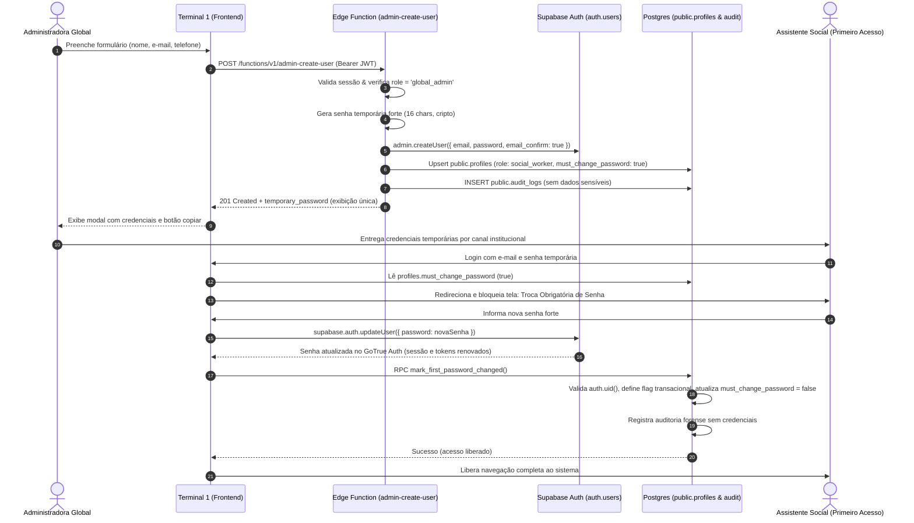

# 10. Cadastro Administrativo sem E-mail e Troca Obrigatória de Senha

Este documento especifica formalmente o contrato de backend implementado para o **AssistSocial**, destinado à integração com o Frontend (Terminal 1) e governança operacional.

---

## 1. Visão Geral da Arquitetura

O fluxo administrativo permite que a **Administradora Global** crie novos profissionais (assistentes sociais) diretamente no sistema sem depender de provedor de e-mail transacional (SMTP) ou disparo de links externos (`inviteUserByEmail`).



---

## 2. Nomes das Edge Functions e Compatibilidade

Para garantir 100% de compatibilidade tanto com novos desenvolvimentos quanto com o código legado do frontend:

| Nome da Função | Endpoint URL | Finalidade |
| :--- | :--- | :--- |
| **`admin-create-user`** (Principal) | `https://mnhzikgphdhohlhfsljz.supabase.co/functions/v1/admin-create-user` | Endpoint canônico da especificação atual. |
| **`admin-invite-user`** (Legado / Compatibilidade) | `https://mnhzikgphdhohlhfsljz.supabase.co/functions/v1/admin-invite-user` | Atualizado com o exato mesmo contrato para suportar chamadas legadas do frontend sem quebras. |

---

## 3. Contrato da API (Requisição e Resposta)

### 3.1. Cabeçalhos Obrigatórios (Headers)

```http
POST /functions/v1/admin-create-user HTTP/1.1
Host: mnhzikgphdhohlhfsljz.supabase.co
Authorization: Bearer <JWT_DA_ADMINISTRADORA_GLOBAL>
apikey: <SUPABASE_ANON_KEY>
Content-Type: application/json
```

### 3.2. Formato da Requisição (Payload)

Aceita tanto campos em `snake_case` quanto `camelCase`:

```json
{
  "email": "maria.silva@cras.gov.br",
  "full_name": "Maria da Silva Pereira",
  "phone": "(11) 98765-4321"
}
```

> **Atenção:** Qualquer tentativa do cliente de enviar `role`, `email_confirm` ou flags privilegiadas é descartada pelo servidor. O papel é fixado incondicionalmente como `'social_worker'`.

### 3.3. Formato da Resposta de Sucesso (`201 Created`)

```json
{
  "success": true,
  "message": "Profissional cadastrado com sucesso. Nenhuma mensagem por e-mail foi disparada.",
  "user": {
    "id": "f47ac10b-58cc-4372-a567-0e02b2c3d479",
    "email": "maria.silva@cras.gov.br",
    "full_name": "Maria da Silva Pereira",
    "role": "social_worker",
    "must_change_password": true
  },
  "temporary_password": "K7#mP9$xL2@qR5*z"
}
```

> **Comportamento da Senha Temporária:**
> - Gerada no servidor via gerador pseudo-aleatório criptográfico (`crypto.getRandomValues`).
> - Tamanho de 16 caracteres garantindo alta entropia (maiúsculas, minúsculas, números e caracteres especiais).
> - Retornada **uma única vez** nesta resposta HTTP para exibição na modal do frontend.
> - **Nunca** é salva em texto puro no banco de dados.
> - **Nunca** é registrada em `public.audit_logs` nem nos logs de console/Edge Function.
> - **Nunca** é enviada por e-mail.

### 3.4. Erros HTTP Possíveis

| Status | Código / Motivo | Exemplo de Resposta |
| :--- | :--- | :--- |
| **`400 Bad Request`** | Parâmetro inválido ou ausente | `{"error": "E-mail inválido ou ausente."}` ou `{"error": "O nome completo é obrigatório."}` |
| **`401 Unauthorized`** | Token JWT ausente ou expirado | `{"error": "Não autorizado: Token de autenticação ausente."}` |
| **`403 Forbidden`** | Chamador não é `global_admin` | `{"error": "Acesso negado: Apenas a Administradora Global pode cadastrar novos profissionais."}` |
| **`405 Method Not Allowed`**| Método HTTP diferente de POST/OPTIONS | `{"error": "Método não permitido. Utilize POST."}` |
| **`409 Conflict`** | E-mail já cadastrado | `{"error": "Este e-mail já está cadastrado no sistema."}` |
| **`500 Internal Error`** | Falha de serviço ou infraestrutura | `{"error": "Falha ao consolidar perfil institucional. Usuário removido para evitar inconsistência: ..."}` |

---

## 4. Garantias de Integridade e Rollback Seguro (Anti-Órfãos)

Para evitar a criação de contas órfãs no Supabase Auth caso ocorra uma falha de rede ou validação no banco de dados relacional:

1. O usuário é instanciado em `auth.users` via `adminClient.auth.admin.createUser()`.
2. Em seguida, o perfil institucional é consolidado na tabela `public.profiles`.
3. Caso a inserção/atualização em `public.profiles` falhe:
   - A Edge Function executa imediatamente uma **estratégia de compensação**: invoca `adminClient.auth.admin.deleteUser(newUserId)`.
   - Isso expurga o usuário recém-criado de `auth.users`, impedindo a persistência de contas inconsistentes e permitindo nova tentativa limpa.

---

## 5. Revisão Crítica de Segurança e Fluxo Oficial de Troca de Senha

### 5.1. Auditoria de Segurança: Eliminação de `complete_first_password_change`
Durante a auditoria da Fase 2, o mecanismo anterior `complete_first_password_change(p_new_password TEXT)` foi avaliado e **formalmente rejeitado e removido** pelas seguintes razões críticas de segurança:
1. **Vazamento de Credenciais em Logs SQL:** Ao trafegar a nova senha como argumento de uma função PL/pgSQL (`p_new_password`), o texto plano da senha podia ser gravado em tabelas de diagnóstico do PostgreSQL (`pg_stat_statements`), logs do servidor ou buffers de replicação.
2. **Contorno das Políticas de Senha do GoTrue:** A alteração direta em `auth.users.encrypted_password` contornava as políticas de força de senha, validações de senha comprometida (leaked password protection), histórico de senhas e webhooks de autenticação do Supabase.
3. **Privilégio Excessivo:** Criava uma dependência de `SECURITY DEFINER` com escrita direta no schema interno `auth`, aumentando a superfície de ataque caso ocorresse vulnerabilidade de injeção ou elevação.

### 5.2. Fluxo Oficial e Seguro Adotado
O AssistSocial consolidou exclusivamente o **fluxo oficial preconizado pelo Supabase Auth**:

1. **Passo 1 (Supabase Auth Client):** O usuário autenticado com a senha temporária altera sua senha utilizando o SDK oficial:
   ```typescript
   const { error } = await supabase.auth.updateUser({
     password: novaSenhaForte
   });
   ```
   - O GoTrue valida os critérios de segurança, calcula o hash criptográfico seguro (bcrypt) internamente e revoga sessões anteriores se configurado.

2. **Passo 2 (Confirmação Protegida via RPC):** Após o retorno com sucesso do Auth, o frontend invoca a RPC:
   ```typescript
   const { data, error } = await supabase.rpc('mark_first_password_changed');
   ```

### 5.3. Controles de Segurança da RPC `mark_first_password_changed`
A migration `20261027170008_mandatory_password_change.sql` implementa os seguintes controles rigorosos:
- **Identidade Estrita via `auth.uid()`:** A RPC extrai a identidade diretamente do token JWT do chamador. Não aceita ID por parâmetro, tornando impossível a um usuário alterar o status de outro.
- **Configuração de Contexto de Sessão Protegida:** A RPC define uma flag transacional (`set_config('assistsocial.in_password_change_rpc', 'true', true)`) que é verificada pela trigger `prevent_profile_tampering`.
- **Proteção Anti-Adulteração (`trg_prevent_profile_tampering`):**
  - Usuários comuns são estritamente impedidos de alterar seu `role` (apenas `global_admin` pode).
  - Usuários comuns são estritamente impedidos de alterar `must_change_password` diretamente via `UPDATE` na tabela `public.profiles`. Qualquer tentativa sem a flag transacional ativa é rejeitada com erro `42501`.
- **Search Path Seguro:** A função foi blindada com `SET search_path = public, auth, pg_temp;`, prevenindo ataques de sequestro de schema.
- **Restrição de Execução:** `REVOKE ALL ON FUNCTION public.mark_first_password_changed() FROM PUBLIC;` e `GRANT EXECUTE TO authenticated;`.
- **Auditoria Forense sem Credenciais:** A conclusão da troca de senha é gravada em `public.audit_logs` contendo apenas o `actor_id`, timestamp e ação `auth.password_changed_first_access`, sem reter senhas nem dados sensíveis.

---

## 6. Diagnóstico de Publicação Remota e Migrações

### 6.1. Estado Auditado do Projeto Remoto (`mnhzikgphdhohlhfsljz`)
- **Edge Functions:**
  - `https://mnhzikgphdhohlhfsljz.supabase.co/functions/v1/admin-create-user` $\rightarrow$ **PUBLICADA E OPERACIONAL** (Retorna 200 OK no preflight OPTIONS com CORS liberado e 401 Unauthorized para chamadas não autenticadas).
  - `https://mnhzikgphdhohlhfsljz.supabase.co/functions/v1/admin-invite-user` $\rightarrow$ **PUBLICADA E OPERACIONAL** (CORS e autenticação ativos).
- **Banco de Dados Remoto:**
  - Migrações 01 a 06: Tabelas criadas no banco de dados, porém não registradas na tabela `supabase_migrations.schema_migrations`.
  - Migrações 07 (`analytics_and_indicators.sql`) e 08 (`mandatory_password_change.sql`): Pendentes de aplicação remota.

### 6.2. Procedimento de Aplicação e Reconciliação do Histórico
Para aplicar as migrações 07 e 08 de forma consistente e reconciliar o histórico da CLI:

```bash
# 1. Reconciliar migrações 01 a 06 como já aplicadas remotamente
npx supabase migration repair --status applied 20261027170001 --project-ref mnhzikgphdhohlhfsljz
npx supabase migration repair --status applied 20261027170002 --project-ref mnhzikgphdhohlhfsljz
npx supabase migration repair --status applied 20261027170003 --project-ref mnhzikgphdhohlhfsljz
npx supabase migration repair --status applied 20261027170004 --project-ref mnhzikgphdhohlhfsljz
npx supabase migration repair --status applied 20261027170005 --project-ref mnhzikgphdhohlhfsljz
npx supabase migration repair --status applied 20261027170006 --project-ref mnhzikgphdhohlhfsljz

# 2. Executar dry-run para confirmar que apenas 07 e 08 serão enviadas
npx supabase db push --dry-run --project-ref mnhzikgphdhohlhfsljz

# 3. Aplicar as migrações pendentes no banco de produção
npx supabase db push --project-ref mnhzikgphdhohlhfsljz
```
