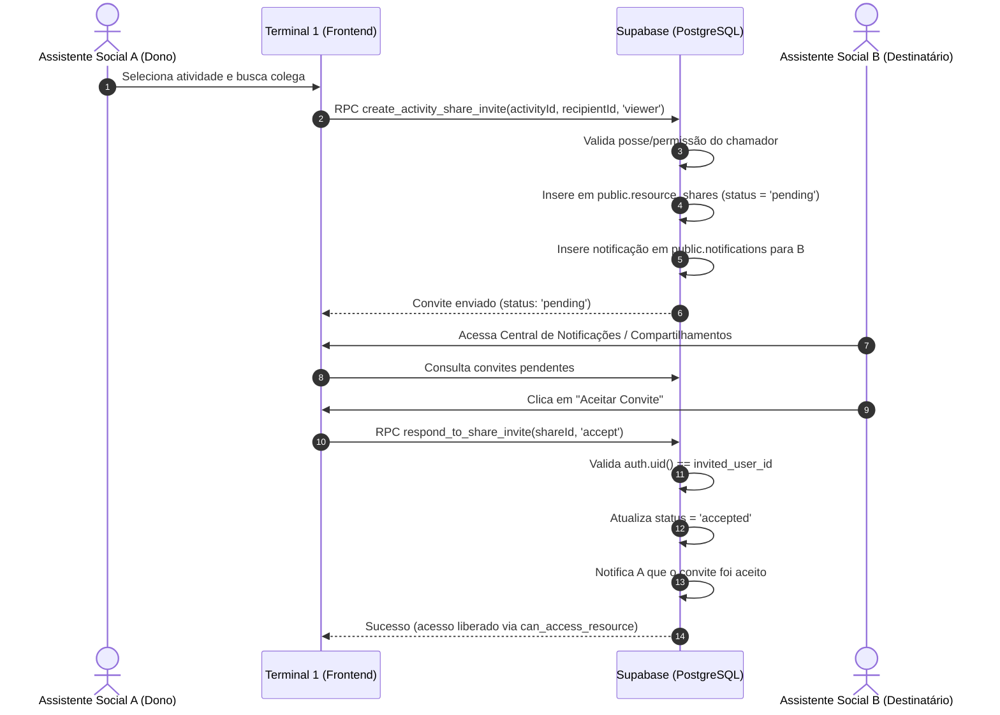

# 11. Notificações Internas, Convites de Compartilhamento, Pesquisa Segura de Usuários, Residenciais e Lembretes

Este documento detalha a arquitetura, modelos de dados, funções RPC e políticas de segurança implementadas na **Migração 10** (`20261027170010_notifications_shares_residenciais_and_reminders.sql`), atendendo integralmente às diretrizes do prompt **Jana 2**.

---

## 1. Notificações Internas (`public.notifications`)

Permite o envio, listagem e controle de alertas dentro do próprio sistema, sem disparo de e-mails externos.

### 1.1. Modelo da Tabela
| Campo | Tipo | Descrição |
| :--- | :--- | :--- |
| `id` | `UUID PRIMARY KEY` | Identificador único da notificação |
| `user_id` | `UUID REFERENCES profiles(id)` | Usuário destinatário (isolado via RLS) |
| `type` | `TEXT` | Tipo: `'share_invite'`, `'share_response'`, `'reminder'`, `'system'`, `'activity'` |
| `title` | `TEXT` | Título da notificação |
| `content` | `TEXT` | Conteúdo legível |
| `resource_type` | `TEXT` | Recurso vinculado (`'activity'`, `'document'`, `'residential'`, etc.) |
| `resource_id` | `UUID` | ID do registro associado |
| `is_read` | `BOOLEAN` | Estado de leitura (`false` por padrão) |
| `read_at` | `TIMESTAMPTZ` | Timestamp da leitura |
| `created_at` | `TIMESTAMPTZ` | Timestamp de criação |

### 1.2. RPCs Disponíveis
* **`public.get_unread_notifications_count()`**: Retorna a quantidade de notificações não lidas do usuário autenticado.
  ```typescript
  const { data: count, error } = await supabase.rpc('get_unread_notifications_count');
  ```
* **`public.mark_notification_read(p_notification_id)`**: Marca uma notificação específica como lida, validando estritamente a posse do destinatário.
  ```typescript
  const { data, error } = await supabase.rpc('mark_notification_read', {
    p_notification_id: '...'
  });
  ```
* **`public.mark_all_notifications_read()`**: Marca todas as notificações do usuário chamador como lidas em uma única transação.
  ```typescript
  const { data, error } = await supabase.rpc('mark_all_notifications_read');
  ```

---

## 2. Convites e Aceitação de Compartilhamento de Atividades

Fluxo formal em que o compartilhamento começa em estado `pending`, gerando notificação interna para o colega, que pode **aceitar** ou **recusar** dentro da interface. O acesso à atividade só é concedido após aceitação explícita.



### 2.1. RPCs de Compartilhamento
* **`public.create_activity_share_invite(p_activity_id, p_recipient_user_id, p_permission)`**:
  * Impede compartilhamento consigo mesmo.
  * Impede duplicatas (erro amigável `23505` caso já haja convite pendente ou acesso ativo).
  * Cria notificação interna automática para o destinatário.
* **`public.respond_to_share_invite(p_share_id, p_action)`**:
  * `p_action`: `'accept'` ou `'reject'` (`'decline'`).
  * Valida que o usuário logado é o real destinatário do convite.
  * Valida que o convite está em estado `'pending'`.
  * Atualiza o status e notifica o remetente da decisão.

---

## 3. Pesquisa Segura de Usuários para Compartilhamento

### 3.1. RPC `public.search_users_for_sharing(p_query, p_limit)`
Previne enumeração em massa e protege metadados confidenciais:
* Exige no mínimo 2 caracteres de busca (`trim(p_query)`).
* Limita o retorno a no máximo 20 resultados (`LEAST(p_limit, 20)`).
* Exclui o próprio chamador dos resultados.
* Retorna estritamente: `id`, `full_name`, `email`, `role`, `avatar_url`.
* Zero exposição de senhas, tokens ou dados pessoais sensíveis.

```typescript
const { data: users, error } = await supabase.rpc('search_users_for_sharing', {
  p_query: 'Maria',
  p_limit: 10
});
```

---

## 4. Cadastro, Consulta e Edição de Residenciais (`public.residenciais`)

Consolidação completa para governança de empreendimentos sociais com integridade referencial:

### 4.1. Campos
* `id`: UUID PRIMARY KEY
* `slug`: Identificador único (`'paupina'`, `'joaquim_machado'`, etc.)
* `name`: Nome oficial do conjunto habitacional (obrigatório)
* `address`: Endereço completo (obrigatório)
* `blocks_count`: Quantidade de blocos (inteiro >= 0)
* `floors_count`: Quantidade de andares (inteiro >= 0)
* `pcd_adapted_units_count`: Apartamentos adaptados para PCD (inteiro >= 0)
* `description`: Observações técnicas

### 4.2. Políticas RLS
* **Leitura (SELECT):** Permitida para todos os profissionais autenticados.
* **Criação (INSERT):** Permitida para profissionais autenticados (`created_by = auth.uid()`).
* **Edição (UPDATE):** Permitida ao criador do registro ou à Administradora Global.
* **Exclusão (DELETE):** Restrita à Administradora Global.

---

## 5. Lembretes Internos (`public.reminders`)

Estrutura persistente para gestão de prazos e tarefas de atendimento pelo próprio profissional.

### 5.1. Campos
* `id`: UUID PRIMARY KEY
* `user_id`: UUID REFERENCES profiles(id)
* `title`: Título do lembrete (obrigatório)
* `description`: Detalhes adicionais
* `remind_at`: Data e hora programada
* `is_completed`: Booleano de conclusão (`false` padrão)
* `activity_id`: Vinculação opcional a uma atividade

### 5.2. RPC `public.toggle_reminder_completed(p_reminder_id)`
Alterna o status do lembrete entre concluído e pendente de forma atômica e segura.
