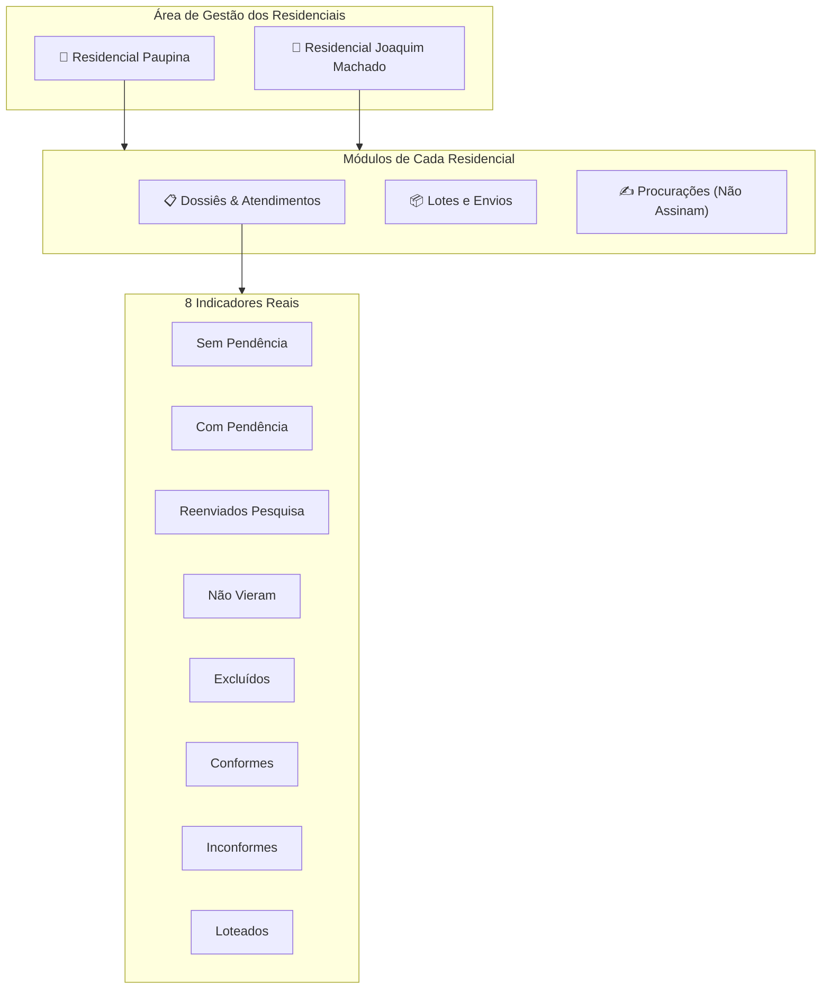

# 11. Residenciais (Paupina e Joaquim Machado), Dossiês, Lotes e Anexos de Atividades

Este documento descreve as funcionalidades de gestão territorial, controle de dossiês, organização de lotes de envio, aba de procurações e anexos de relatórios implementados no **AssistSocial** (Terminal 3).

---

## 1. Visão Geral da Arquitetura

O sistema atende a duas áreas habitacionais de alta relevância social no município:
- **Residencial Paupina** (`slug: paupina`)
- **Residencial Joaquim Machado** (`slug: joaquim_machado`)

A integridade do sistema garante **isolamento estrito**: dossiês, lotes e pendências de um residencial jamais se misturam aos do outro residencial.



---

## 2. Modelo de Dados e Migração 09

A migração [`supabase/migrations/20261027170009_residenciais_dossiers_lots_and_attachments.sql`](file:///C:/Users/Londres31/Documents/DEV/supabase/migrations/20261027170009_residenciais_dossiers_lots_and_attachments.sql) introduz três estruturas principais:

### 2.1. `public.residential_batches` (Lotes e Envios)
- `id`: UUID chave primária.
- `residencial_slug`: `'paupina'` ou `'joaquim_machado'`.
- `name`: Identificação do lote (ex: "Lote 1", "Lote 2", "Remessa Especial").
- `dispatch_date`: Data de envio do lote.
- `status`: `'draft'`, `'enviado'`, `'em_processamento'`, `'concluido'`, `'arquivado'`.
- `notes`: Observações técnicas sobre a remessa.
- `created_by`: Vínculo com a profissional responsável em `profiles.id`.

### 2.2. `public.dossiers` (Dossiês das Famílias)
- `id`: UUID chave primária.
- `residencial_slug`: Isolamento territorial (`'paupina'` ou `'joaquim_machado'`).
- `code`: Código do dossiê (ex: `DOS-PAU-001`).
- `person_name`: Nome completo do titular atendido.
- `unit_number`: Bloco / Apartamento / Unidade.
- `operational_status`: Situação operacional independente (`'sem_pendencia'`, `'com_pendencias'`, `'reenviado_pesquisa'`, `'nao_veio'`, `'excluido'`).
- `compliance_status`: Conformidade documental independente (`'conforme'`, `'inconforme'`, `'neutro'`).
- `batch_id`: FK para `residential_batches.id` (Dossiês Loteados).
- `needs_proxy`: Booleano identificando quem não assina e necessita de procuração.
- `proxy_status`: Situação da representação (`'nao_se_aplica'`, `'pendente'`, `'em_andamento'`, `'concluida'`).
- `proxy_reason`: Motivo do impedimento (ex: "Analfabetismo", "Impedimento motor").

### 2.3. `public.activity_attachments` (Relatórios e Anexos de Atividades)
- `id`: UUID.
- `activity_id`: FK para `public.activities.id` (ON DELETE CASCADE).
- `uploader_id`: FK para `public.profiles.id`.
- `storage_path`: Caminho seguro no bucket privado `documents` (`{user_id}/activities/{activity_id}/{timestamp}_{filename}`).
- `original_name`: Nome original do arquivo.
- `mime_type`: Tipo MIME validado (PDF, DOCX, XLSX, etc.).
- `file_size`: Tamanho em bytes (limite de 25 MB).

---

## 3. Os 8 Indicadores Dinâmicos

Diferente de modelos estáticos, o AssistSocial calcula os 8 indicadores em tempo de consulta direta:

1. **Sem Pendência:** `operational_status = 'sem_pendencia'`
2. **Com Pendências:** `operational_status = 'com_pendencias'`
3. **Reenviados para Pesquisa:** `operational_status = 'reenviado_pesquisa'`
4. **Não Vieram:** `operational_status = 'nao_veio'`
5. **Excluídos:** `operational_status = 'excluido'`
6. **Conformes:** `compliance_status = 'conforme'`
7. **Inconformes:** `compliance_status = 'inconforme'`
8. **Loteados:** `batch_id IS NOT NULL`

> **Regra de Independência:** Um dossiê pode ser classificado como *Conforme* e simultaneamente estar *Sem Pendência* e *Loteado*. Os estados não são concorrentes nem excludentes.

---

## 4. Aba de Procurações (Não Assinam)

Centraliza todos os titulares que possuem impedimento físico ou legal para assinar documentos e contratos habitacionais:
- Permite registrar o motivo específico (ex: analfabetismo, limitação motora severa, incapacidade civil).
- Permite acompanhar as providências cartoriais/jurídicas em 3 estágios: `pendente` $\rightarrow$ `em_andamento` $\rightarrow$ `concluida`.

---

## 5. Resolução do Erro em Produção (`must_change_password` e Schema Cache)

### Diagnóstico do Erro 500 no Supabase Cloud (`mnhzikgphdhohlhfsljz`):
A mensagem:
```text
Falha ao consolidar perfil institucional. Usuário removido para evitar inconsistência: Could not find the 'must_change_password' column of 'profiles' in the schema cache
```
Ocorre porque a Edge Function foi implantada no ambiente de nuvem, porém:
1. A migration `20261027170008_mandatory_password_change.sql` ainda não foi executada no banco de dados remoto da nuvem.
2. O PostgREST mantém um cache em memória das colunas da tabela `profiles`.

### Ação para o Operador no Supabase Cloud:
Execute no **SQL Editor** do Supabase (`mnhzikgphdhohlhfsljz`):
```sql
-- 1. Garante a coluna must_change_password
ALTER TABLE public.profiles
ADD COLUMN IF NOT EXISTS must_change_password BOOLEAN NOT NULL DEFAULT false;

-- 2. Força o PostgREST a recarregar o cache do schema imediatamente
NOTIFY pgrst, 'reload schema';
```
Ou, alternativamente, sincronize as migrações via CLI:
```bash
npx supabase db push --project-ref mnhzikgphdhohlhfsljz
```
