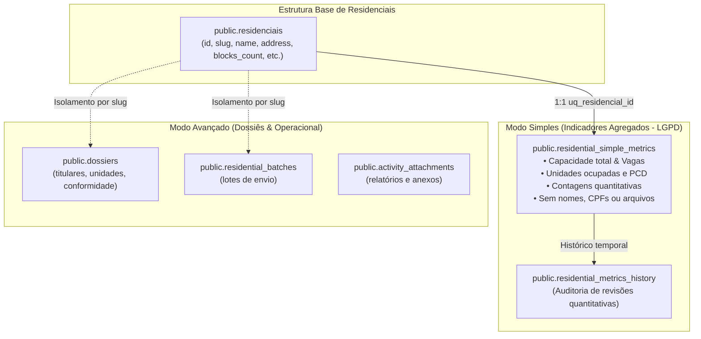

# 12. Modo Simples dos Residenciais — Indicadores Agregados e Sigilo LGPD

Este documento detalha a arquitetura, modelo de dados, políticas de segurança e funções RPC do **Modo Simples** do módulo de Residenciais do AssistSocial, implementado via **Migration 11** ([`supabase/migrations/20261027170011_residential_simple_mode_metrics.sql`](file:///C:/Users/Londres31/Documents/DEV/supabase/migrations/20261027170011_residential_simple_mode_metrics.sql)).

---

## 1. Visão Geral e Justificativa

Em muitas rotinas de assistência social e habitacional, assistentes sociais precisam acompanhar o panorama de empreendimentos habitacionais (como **Residencial Paupina** e **Residencial Joaquim Machado**) consolidando indicadores quantitativos agregados, sem que haja autorização prévia ou necessidade de lançar nomes, CPFs, dossiês individuais ou documentos pessoais sigilosos no sistema.

O **Modo Simples** foi concebido especificamente para:
1. **Permitir a gestão puramente quantitativa e agregada** por residencial.
2. **Garantir 100% de sigilo e conformidade com a LGPD e o Código de Ética do CFESS/CRESS**: zero campos para nomes de cidadãos, CPFs, identificadores individuais ou uploads de documentos pessoais.
3. **Preservar a total integridade do Modo Avançado**: as tabelas de dossiês (`public.dossiers`), lotes de envio (`public.residential_batches`) e procurações continuam existindo e operando de forma autônoma e independente.



---

## 2. Modelo de Dados

### 2.1. Tabela Principal: `public.residential_simple_metrics`

Armazena o estado atual dos indicadores agregados de cada residencial cadastrado.

| Coluna | Tipo | Restrições | Descrição |
| :--- | :--- | :--- | :--- |
| `id` | `UUID` | `PRIMARY KEY DEFAULT gen_random_uuid()` | Identificador único do registro de métricas |
| `residencial_id` | `UUID` | `NOT NULL REFERENCES public.residenciais(id) ON DELETE CASCADE UNIQUE` | Vínculo 1:1 com o residencial |
| `residencial_slug` | `TEXT` | `NOT NULL REFERENCES public.residenciais(slug) ON DELETE CASCADE` | Slug de navegação territorial |
| `total_capacity` | `INTEGER` | `CHECK (total_capacity >= 0)` | Capacidade habitacional total planejada |
| `occupied_units` | `INTEGER` | `CHECK (occupied_units >= 0)` | Quantidade de unidades efetivamente ocupadas |
| `available_units` | `INTEGER` | `CHECK (available_units >= 0)` | Quantidade de unidades vagas disponíveis |
| `pcd_adapted_units` | `INTEGER` | `CHECK (pcd_adapted_units >= 0)` | Quantidade de unidades adaptadas para PCD |
| `pending_documents_count` | `INTEGER` | `CHECK (>= 0)` | Pessoas/famílias com documentação pendente |
| `regular_documents_count` | `INTEGER` | `CHECK (>= 0)` | Pessoas/famílias com documentação regular |
| `dossiers_no_pending_count` | `INTEGER` | `CHECK (>= 0)` | Dossiês sem pendências |
| `dossiers_with_pending_count` | `INTEGER` | `CHECK (>= 0)` | Dossiês com pendências |
| `dossiers_resubmitted_search_count` | `INTEGER` | `CHECK (>= 0)` | Dossiês reenviados para pesquisa |
| `no_show_count` | `INTEGER` | `CHECK (>= 0)` | Beneficiários que não compareceram |
| `dossiers_excluded_count` | `INTEGER` | `CHECK (>= 0)` | Dossiês formalmente excluídos |
| `dossiers_compliant_count` | `INTEGER` | `CHECK (>= 0)` | Dossiês com parecer conforme |
| `dossiers_non_compliant_count` | `INTEGER` | `CHECK (>= 0)` | Dossiês com parecer inconforme |
| `dossiers_batched_count` | `INTEGER` | `CHECK (>= 0)` | Dossiês organizados em lotes de envio |
| `proxies_needed_count` | `INTEGER` | `CHECK (>= 0)` | Pessoas que necessitam de procuração |
| `notes` | `TEXT` | `NULL` | Observações técnicas e contextuais agregadas |
| `custom_metrics` | `JSONB` | `NOT NULL DEFAULT '{}'::jsonb` | Extensibilidade para novos indicadores |
| `last_updated_by` | `UUID` | `REFERENCES public.profiles(id)` | Identificador do profissional responsável |
| `created_at` | `TIMESTAMPTZ` | `DEFAULT timezone('utc', now())` | Data de criação do registro |
| `updated_at` | `TIMESTAMPTZ` | `DEFAULT timezone('utc', now())` | Data da última atualização |

#### Restrição de Consistência
- `CONSTRAINT chk_simple_capacity_consistency`: Garante que `occupied_units <= total_capacity`.
- Todos os campos são opcionais (`NULL`), garantindo que campos não informados não sejam assumidos falsamente como "zero" até que a equipe inicie seu preenchimento.

---

### 2.2. Tabela de Auditoria Quantitativa: `public.residential_metrics_history`

Cada atualização realizada no Modo Simples gera um instantâneo imutável na tabela de histórico, possibilitando auditoria temporal sem registrar nenhum dado pessoal.

| Coluna | Tipo | Descrição |
| :--- | :--- | :--- |
| `id` | `UUID` | Chave primária |
| `residencial_id` | `UUID` | Vínculo com `public.residenciais` |
| `residencial_slug` | `TEXT` | Slug territorial |
| `metrics_snapshot` | `JSONB` | Fotografia dos valores quantitativos no momento da edição |
| `updated_by` | `UUID` | Usuário autor da alteração (`public.profiles.id`) |
| `reason` | `TEXT` | Motivo ou contexto da atualização |
| `recorded_at` | `TIMESTAMPTZ` | Timestamp da alteração |

---

## 3. Funções Remotas (RPC) Disponíveis para o Frontend

### 3.1. `get_residential_simple_metrics(p_residencial_slug TEXT)`
- **Objetivo**: Recupera os dados cadastrais do residencial e seus indicadores quantitativos atuais, incluindo o nome do último profissional que efetuou alterações.
- **Segurança**: Requer autenticação (`auth.uid() IS NOT NULL`). Rejeita requisições anônimas com `ERRCODE = '42501'`.
- **Retorno**:
```json
{
  "residencial": {
    "id": "bdafdb75-b1a8-4b71-8d78-d490fae38ba4",
    "slug": "paupina",
    "name": "Residencial Paupina",
    "address": "Bairro Paupina, Fortaleza - CE",
    "blocks_count": 12,
    "floors_count": 4,
    "pcd_adapted_units_count": 8
  },
  "metrics": {
    "id": "...",
    "total_capacity": 120,
    "occupied_units": 98,
    "available_units": 22,
    "pcd_adapted_units": 12,
    "pending_documents_count": 8,
    "regular_documents_count": 87,
    "dossiers_no_pending_count": 70,
    "dossiers_with_pending_count": 15,
    "dossiers_resubmitted_search_count": 5,
    "no_show_count": 3,
    "dossiers_excluded_count": 2,
    "dossiers_compliant_count": 83,
    "dossiers_non_compliant_count": 15,
    "dossiers_batched_count": 65,
    "proxies_needed_count": 4,
    "notes": "Indicadores quantitativos consolidados.",
    "last_updated_by": "0d8250e0-c0c8-4385-b129-24ef6ccd29e4",
    "last_updated_by_name": "Janaína Lima",
    "updated_at": "2026-10-27T21:35:00Z"
  }
}
```

---

### 3.2. `upsert_residential_simple_metrics(p_residencial_slug TEXT, p_metrics JSONB)`
- **Objetivo**: Salva ou atualiza atomicamente os indicadores agregados do residencial.
- **Validações de Backend**:
  1. Autenticação obrigatória.
  2. Existência do residencial (código `P0002` se não encontrado).
  3. Rejeição de números negativos (código `22023`).
  4. Validação de capacidade (`occupied_units <= total_capacity`).
  5. Registro atômico no histórico de auditoria (`public.residential_metrics_history`).
  6. Registro de trilha forense em `public.audit_logs`.

---

### 3.3. `get_residential_metrics_history(p_residencial_slug TEXT, p_limit INTEGER)`
- **Objetivo**: Lista os últimos instantâneos de indicadores para acompanhamento da evolução temporal do residencial.
- **Limite Padrão**: 10 registros (máximo 50).

---

## 4. Segurança e Row Level Security (RLS)

1. **`public.residential_simple_metrics`**:
   - `SELECT`: Usuários autenticados (`auth.uid() IS NOT NULL`).
   - `INSERT`: Usuários autenticados via RPC ou direto.
   - `UPDATE`: Usuários autenticados registrando `last_updated_by = auth.uid()`.
   - `DELETE`: Exclusivo para administradores globais (`public.is_global_admin(auth.uid())`).
2. **`public.residential_metrics_history`**:
   - `SELECT`: Usuários autenticados.
   - `INSERT`: Usuários autenticados (append-only).
   - `UPDATE` / `DELETE`: Desabilitados (tabela imutável de auditoria).

---

## 5. Validação e Testes Automatizados

A suíte [`supabase/tests/residential_simple_mode_test.js`](file:///C:/Users/Londres31/Documents/DEV/supabase/tests/residential_simple_mode_test.js) valida os 10 requisitos do módulo diretamente no Supabase em produção:

1. **Criação de indicadores** para o residencial Paupina (`upsert_residential_simple_metrics`).
2. **Atualização** de valores existentes com preservação e overwrite correto.
3. **Persistência remota** consultada via RPC após simulação de recarregamento.
4. **Rejeição de números negativos** tanto pela constraint de banco quanto pela RPC.
5. **Rejeição de inconsistência de capacidade** (`occupied_units > total_capacity`).
6. **Rejeição de residencial inexistente** com erro explícito `P0002`.
7. **Bloqueio de acesso anônimo** via RLS/Auth com erro `42501`.
8. **Isolamento estrito entre residenciais**: alterações em Joaquim Machado não tocam Paupina.
9. **Auditoria de sigilo (LGPD)**: comprovação de zero colunas de identificação de moradores.
10. **Independência do Modo Avançado**: confirmação de que `dossiers` e `residential_batches` permanecem ativos e inalterados.
11. **Idempotência**: execução repetida de operações não duplica linhas nem corrompe o histórico.
