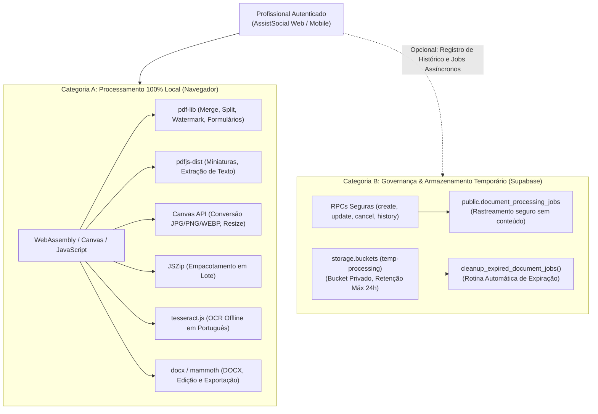

# 13. Central de Ferramentas — Processamento Seguro de Documentos e Sigilo LGPD

Este documento descreve a arquitetura técnica, a governança de jobs, as diretrizes de segurança da informação (LGPD/CFESS) e os contratos de API para a **Central de Ferramentas** do AssistSocial, implementada via **Migration 13** ([`supabase/migrations/20261027170013_tools_and_document_processing.sql`](file:///C:/Users/Londres31/Documents/DEV/supabase/migrations/20261027170013_tools_and_document_processing.sql)).

---

## 1. Visão Geral da Arquitetura

Assistentes sociais lidam rotineiramente com certidões, laudos médicos, fotos de visitas domiciliares, termos de posse e estudos sociais confidenciais. A exposição desses documentos em conversores públicos de terceiros (como Smallpdf ou iLovePDF) representa grave infração à LGPD e ao sigilo ético profissional.

A Central de Ferramentas do AssistSocial adota uma **estratégia de processamento híbrido orientada à privacidade (Privacy by Design)**:

### Princípios Fundamentais:
1. **Zero Trânsito de Documentos Confidenciais**: 95% das operações executam na memória RAM do próprio navegador do usuário, garantindo velocidade instantânea e custo zero de infraestrutura.
2. **Zero Persistência de Conteúdo no Banco de Dados**: A tabela de histórico registra apenas o tipo de ferramenta, nome de arquivo, formato e bytes finais para fins de auditoria do próprio usuário. Nenhum texto extraído ou dado pessoal é salvo.
3. **Isolamento Estrito**: Cada profissional acessa e cancela exclusivamente os seus próprios trabalhos (`user_id = auth.uid()`).

---

## 2. Bibliotecas de Código Aberto Homologadas e Licenças

Todas as bibliotecas adotadas são 100% gratuitas, de código aberto e com licenças permissivas que dispensam o pagamento de royalties ou APIs proprietárias:

| Biblioteca | Versão / Ecossistema | Licença | Finalidade Principal |
| :--- | :--- | :--- | :--- |
| **`pdf-lib`** | npm: `pdf-lib` | **MIT** | Junção, divisão, rotação, marca-d'água, numeração de páginas e formulários PDF |
| **`pdfjs-dist`** | npm: `pdfjs-dist` | **Apache 2.0** | Extração de texto de PDFs, contagem de páginas e renderização de miniaturas |
| **`docx`** | npm: `docx` | **MIT** | Criação, estilização, edição e exportação programática de arquivos Word (`.docx`) |
| **`mammoth`** | npm: `mammoth` | **BSD-2-Clause** | Conversão de documentos `.docx` para HTML/texto com preservação semântica |
| **`jszip`** | npm: `jszip` | **MIT** | Compactação de múltiplos arquivos e relatórios processados em lote |
| **`tesseract.js`** | npm: `tesseract.js` | **Apache 2.0** | Reconhecimento Óptico de Caracteres (OCR) em português (`por`) executado no cliente |
| **Canvas API & Web APIs** | Padrão W3C Nativo | **Padrão Web** | Conversões de imagem (`JPG`, `PNG`, `WEBP`), redimensionamento e compressão sem perdas |

---

## 3. Modelo de Dados e Migração 13

A migração [`supabase/migrations/20261027170013_tools_and_document_processing.sql`](file:///C:/Users/Londres31/Documents/DEV/supabase/migrations/20261027170013_tools_and_document_processing.sql) introduz a estrutura de governança de trabalhos.

### 3.1. Tabela `public.document_processing_jobs`

| Coluna | Tipo | Restrições | Descrição |
| :--- | :--- | :--- | :--- |
| `id` | `UUID` | `PRIMARY KEY DEFAULT gen_random_uuid()` | Identificador aleatório e não previsível do job |
| `user_id` | `UUID` | `NOT NULL REFERENCES public.profiles(id) ON DELETE CASCADE` | Profissional proprietário da operação |
| `operation_type` | `TEXT` | `NOT NULL` | Tipo da ferramenta (ex: `pdf_to_docx`, `images_to_pdf`) |
| `status` | `TEXT` | `CHECK (status IN ('queued', 'processing', 'completed', 'failed', 'cancelled', 'expired'))` | Estado de processamento |
| `original_filename` | `TEXT` | `NULL` | Nome do arquivo original |
| `result_filename` | `TEXT` | `NULL` | Nome do arquivo processado gerado |
| `output_format` | `TEXT` | `NULL` | Extensão ou formato de saída (`pdf`, `docx`, `png`, `zip`) |
| `file_size` | `BIGINT` | `CHECK (file_size >= 0)` | Tamanho em bytes do arquivo gerado |
| `error_code` | `TEXT` | `NULL` | Código não sensível de erro em caso de falha |
| `error_message` | `TEXT` | `NULL` | Mensagem explicativa para o usuário |
| `metadata` | `JSONB` | `NOT NULL DEFAULT '{}'::jsonb` | Metadados técnicos (ex: páginas processadas, taxa de compressão) |
| `created_at` | `TIMESTAMPTZ` | `DEFAULT timezone('utc', now())` | Timestamp de criação |
| `completed_at` | `TIMESTAMPTZ` | `NULL` | Timestamp de conclusão |
| `expires_at` | `TIMESTAMPTZ` | `DEFAULT timezone('utc', now() + interval '24 hours')` | Prazo limite de retenção |

### 3.2. Políticas Row Level Security (RLS)
- **`doc_jobs_select_policy`**: `user_id = auth.uid() OR public.is_global_admin(auth.uid())`
- **`doc_jobs_insert_policy`**: `user_id = auth.uid()`
- **`doc_jobs_update_policy`**: `user_id = auth.uid() OR public.is_global_admin(auth.uid())`
- **`doc_jobs_delete_policy`**: `user_id = auth.uid() OR public.is_global_admin(auth.uid())`

---

## 4. Funções Remotas (RPC) para o Frontend

### 4.1. `create_document_job`
Registra a intenção de processamento no histórico do usuário.
- **Parâmetros**: `p_operation_type TEXT`, `p_original_filename TEXT`, `p_output_format TEXT`, `p_metadata JSONB`.
- **Retorno**: `{ success: true, job_id: UUID, status: "processing", expires_at: string }`.

### 4.2. `update_document_job_status`
Atualiza o estado do trabalho para `completed` (com métricas de tamanho) ou `failed`.
- **Parâmetros**: `p_job_id UUID`, `p_status TEXT`, `p_result_filename TEXT`, `p_file_size BIGINT`, `p_error_code TEXT`, `p_error_message TEXT`, `p_metadata JSONB`.
- **Retorno**: `{ success: true, job_id: UUID, status: string, completed_at: string }`.

### 4.3. `get_user_document_jobs`
Consulta o histórico paginado de operações recentes do usuário logado.
- **Parâmetros**: `p_limit INTEGER DEFAULT 20`.
- **Retorno**: Lista de jobs com ordenação decrescente por `created_at`.

### 4.4. `cancel_document_job`
Cancela um processamento em andamento.
- **Parâmetros**: `p_job_id UUID`.

### 4.5. `cleanup_expired_document_jobs`
Rotina de manutenção automática que marca como `expired` registros com mais de 24 horas e descarta metadados temporários após 7 dias.

---

## 5. Matriz de Ferramentas Implementadas

| Categoria | Ferramenta | Mecanismo | Suporte a Lote | Privacidade LGPD |
| :--- | :--- | :--- | :---: | :---: |
| **A. Conversão** | Imagens para PDF | Local (`pdf-lib`) | Sim | 100% no cliente |
| **A. Conversão** | Juntar múltiplos PDFs | Local (`pdf-lib`) | Sim | 100% no cliente |
| **A. Conversão** | PDF para Imagens (PNG/JPG) | Local (`pdfjs-dist` + Canvas) | Sim | 100% no cliente |
| **A. Conversão** | Conversor PNG / JPG / WEBP | Local (Canvas API) | Sim | 100% no cliente |
| **B. Organização** | Dividir PDF por páginas | Local (`pdf-lib`) | Sim | 100% no cliente |
| **B. Organização** | Extrair / Excluir / Reordenar páginas | Local (`pdf-lib`) | Sim | 100% no cliente |
| **B. Organização** | Girar páginas (90° / 180° / 270°) | Local (`pdf-lib`) | Sim | 100% no cliente |
| **C. Otimização** | Comprimir Imagens (JPEG/PNG/WEBP) | Local (Canvas API) | Sim | 100% no cliente |
| **C. Otimização** | Redimensionar Imagens (Pixels / %) | Local (Canvas API) | Sim | 100% no cliente |
| **D. Edição** | Adicionar Marca-d'água | Local (`pdf-lib`) | Sim | 100% no cliente |
| **D. Edição** | Numeração de Páginas em PDF | Local (`pdf-lib`) | Sim | 100% no cliente |
| **E. DOCX / Word** | Editor de Texto e Exportação DOCX | Local (`docx` + `mammoth`) | Sim | 100% no cliente |
| **F. Segurança** | Inspecionar e Remover Metadados | Local (`pdf-lib`) | Sim | 100% no cliente |
| **F. Segurança** | Proteger PDF com Senha | Local (`pdf-lib`) | Não | Senha nunca é salva |
| **G. Utilidades** | OCR em Português (`tesseract.js`) | Local (Web Worker) | Sim | 100% no cliente |
| **G. Utilidades** | Empacotamento em Arquivo ZIP | Local (`jszip`) | Sim | 100% no cliente |

---

## 6. Testes Automatizados

A suíte [`supabase/tests/tools_document_processing_suite.js`](file:///C:/Users/Londres31/Documents/DEV/supabase/tests/tools_document_processing_suite.js) foi executada e validada com sucesso contra o Supabase remoto:
1. **Autenticação**: Bloqueio de requisições anônimas (`42501`).
2. **Criação de Job**: Validação de parâmetros obrigatórios (`22023`) e persistência segura.
3. **Ciclo de Vida**: Conclusão de jobs (`completed`) e preenchimento de métricas de tamanho.
4. **Resiliência**: Bloqueio de status inválidos e proteção contra cancelamentos repetidos.
5. **Isolamento RLS**: Usuário A não enxerga nem altera jobs de outro usuário.
6. **Auditoria LGPD**: Comprovação de ausência de texto ou dados pessoais no schema.
7. **Limpeza Automática**: Execução homologada de `cleanup_expired_document_jobs()`.
